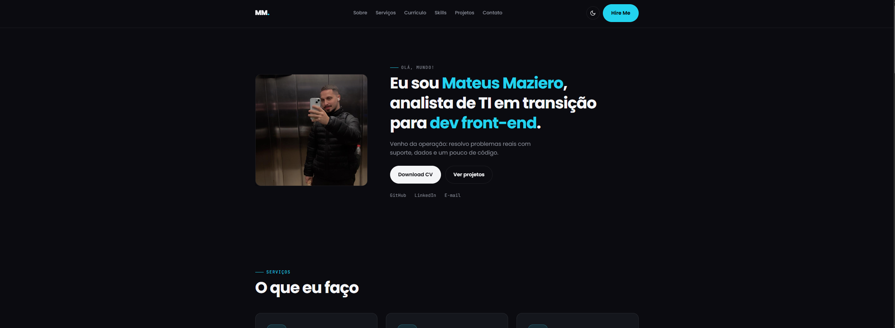

<h1 align="center">Mateus Maziero — Portfólio</h1>

<p align="center">
  Portfólio pessoal construído do zero com HTML, CSS e JavaScript puro.<br>
  Sem frameworks, sem dependências pesadas — só código.
</p>

<p align="center">
  <a href="https://mateusmaziero.netlify.app" target="_blank">
    
  </a>
  <a href="https://www.linkedin.com/in/mateusmaziero" target="_blank">
    
  </a>
  <a href="mailto:mateusmaziero@exemplo.com">
    
  </a>
</p>

<p align="center">
  
  
  
  
</p>

---

## 🎯 Sobre

Portfólio pessoal criado pra mostrar minha transição de **suporte técnico e análise de dados** para **desenvolvimento front-end**.

Em vez de usar um template pronto, decidi construir tudo do zero — cada animação, cada transição, cada detalhe de UI foi escrito à mão. O objetivo não era só ter um portfólio bonito, mas **provar que eu sei construir a interface**, não só falar sobre ela.

> *"Venho da operação: resolvo problemas reais com suporte, dados e um pouco de código."*

---

## 🖼️ Preview

<p align="center">
  
</p>

> 💡 **Dica:** adicione um print ou GIF do site em `preview.png` na raiz do repositório.

---

## ✨ Features

### 🎬 Experiência

- **Preloader cinematográfico** — counter 0→100% com barra animada, trava em 95% até a página carregar de verdade, e libera com chime suave (Web Audio API)
- **Coreografia de entrada** — após o preloader, cada elemento do hero entra em cascata: header desce, foto revela com clip-path, título sobe linha por linha, botões e links aparecem em sequência
- **Reveal on scroll** — todas as seções animam quando entram na viewport (IntersectionObserver)
- **Skill bars animadas** — as barras de progresso crescem da esquerda quando a seção fica visível

### 🌗 Tematização

- **Dark mode como padrão** — paleta escura otimizada pra leitura prolongada
- **Light mode opcional** — toggle no header com **wipe circular animado** (View Transitions API)
- **Sem flash branco** — preferência é aplicada antes do CSS carregar (inline script no `<head>`)
- **Persistência** — escolha do usuário salva em `localStorage`

### 🎨 Detalhes

- **3 ícones SVG customizados** (servidor, gráfico, código) — line-art feito à mão, sem lib de ícones
- **Filtros de projeto** — Todos / Front-end / Dados / Suporte
- **Timeline** de experiência com hover states
- **Responsivo** — mobile, tablet e desktop
- **Acessibilidade** — respeita `prefers-reduced-motion`, contraste AA, navegação por teclado

---

## 🛠️ Stack

| Tecnologia | Uso |
|---|---|
| **HTML5** | Semântica, `<dialog>`, `<time>`, metadados de SEO |
| **CSS3** | Grid, Flexbox, custom properties, `color-mix()`, `clip-path`, animações |
| **JavaScript (ES2020+)** | Web Audio API, IntersectionObserver, View Transitions API, `crypto.randomUUID()` |
| **Google Fonts** | Poppins (display) + JetBrains Mono (técnica) |

**Zero dependências.** Zero `npm install`. Zero build step. Abre o `index.html` e roda.

---

## 🚀 Como rodar localmente

### Opção 1 — Abrir direto

```bash
git clone https://github.com/mateusmaziero/portfolio.git
cd portfolio
# Abre o index.html no navegador (duplo clique)